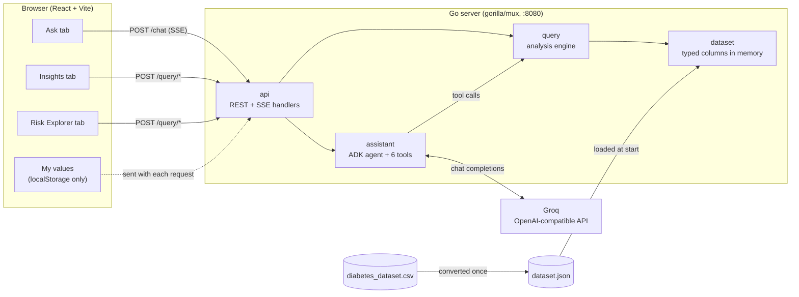
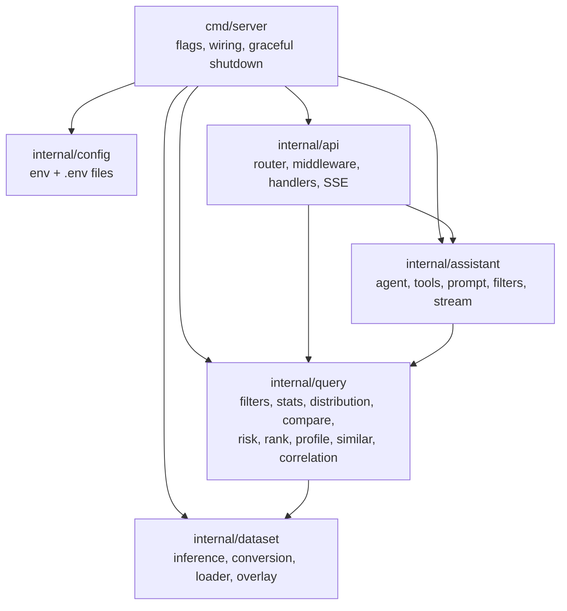
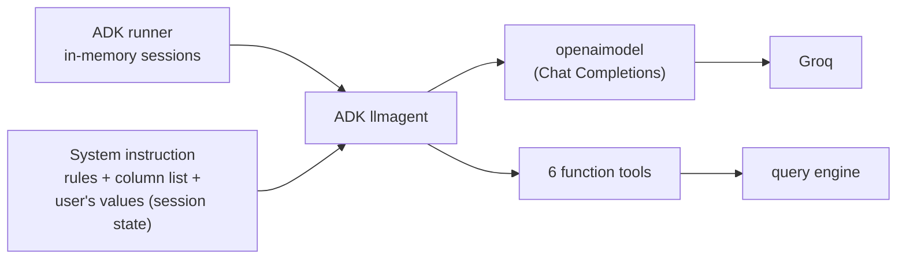
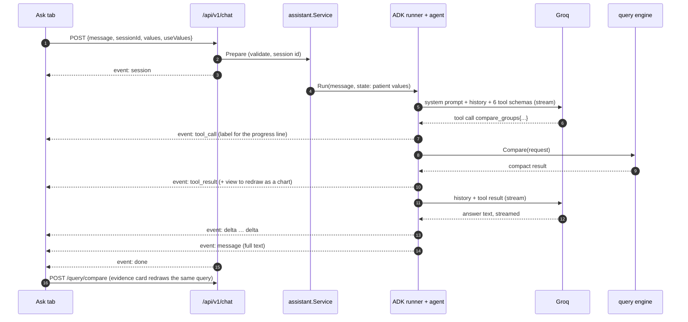
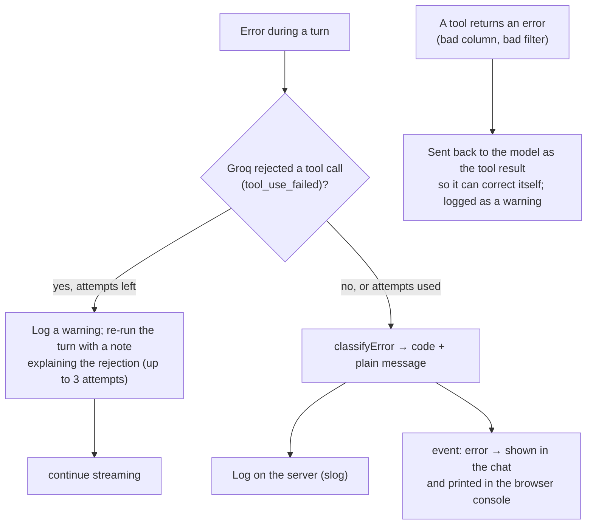
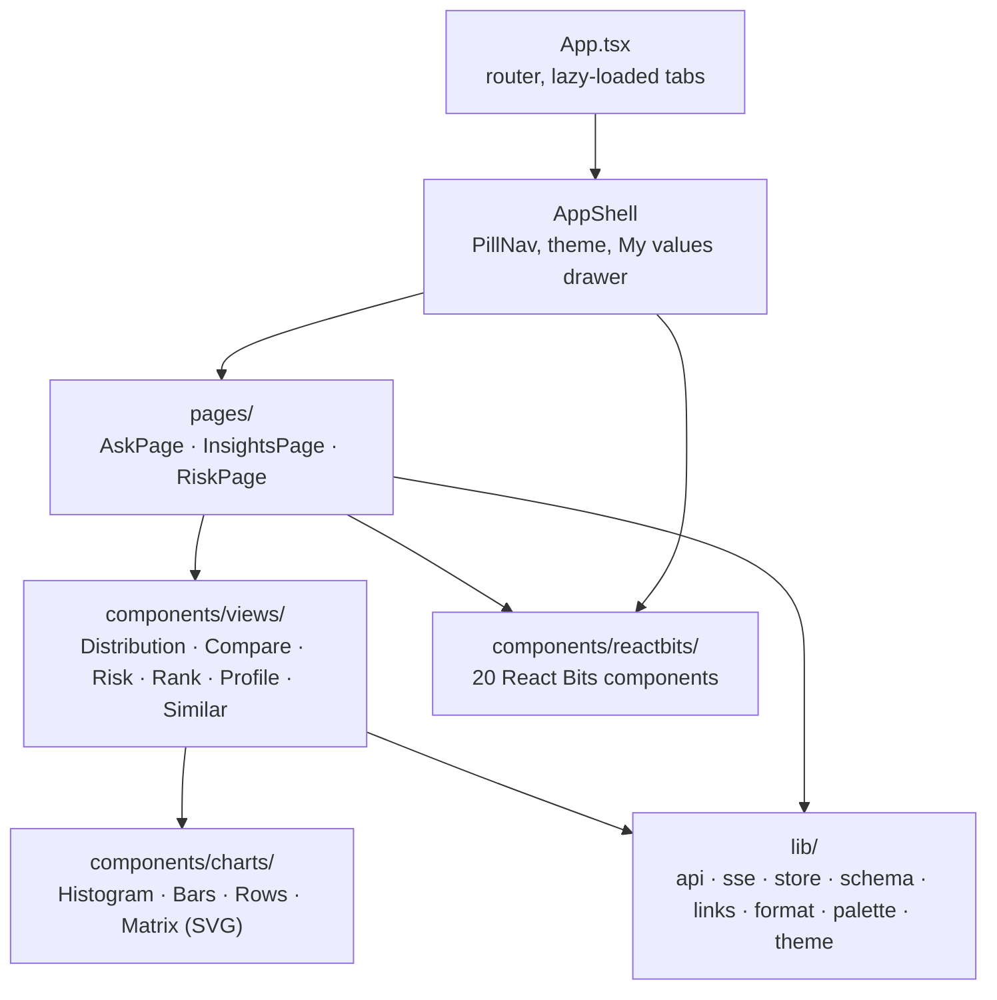
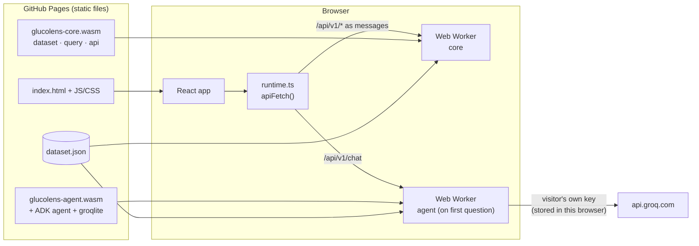

# GlucoLens architecture

GlucoLens compares one person's checkup with 100,000 anonymised checkups. A Go server owns the data and every calculation; a React app draws it; an agent built with Google's Agent Development Kit (ADK) for Go answers questions by calling the same calculations as tools, with the model served by Groq.

## System overview

In development, Vite serves the app on `:5173` and proxies `/api` to the Go server. In production (`npm run build && npm start`) the Go server serves the built app and the API on one port.

## Key design decisions

| Decision | Why |
| --- | --- |
| **The AI never touches the CSV.** It can only call six typed tools. | No file, code or network tools exist for it. Every number it quotes comes from the query engine. |
| **One query engine behind both the charts and the AI.** | An answer and the chart beside it cannot disagree. Each evidence card in Ask re-runs the exact query the tool ran. |
| **CSV → JSON conversion once.** | Parsing and type inference happen when the JSON is missing or the CSV's SHA-256 changes; normal starts load the JSON. |
| **Column types inferred from data, meaning from an overlay.** | A different CSV still works; `columns.meta.json` adds labels, units, sections, clinical bands and level order. |
| **Go + ADK for Go, Groq via its OpenAI-compatible API.** | The team's backend language; ADK's `openaimodel` adapter talks to Groq's Chat Completions endpoint. |
| **Values stay in the browser.** | Saved in localStorage; sent per request for comparisons, and to Groq only when "Use my values" is on. |

## Backend packages

### dataset

1. **Convert** (`convert.go`): read the CSV once; per column decide the kind — `binary` (0/1 or yes/no), `discrete` (≤ 12 integer values), `continuous`, `categorical` (≤ 60 labels) or `text`; record missing values and decimals; write columnar JSON atomically.
2. **Load** (`store.go`): read the JSON, apply the overlay (labels, units, sections, roles, clinical bands, groups, level order, reference group), and precompute stats, sorted arrays and level counts.
3. **Values** (`values.go`): normalise a person's raw values (numbers, labels, yes/no) and pick the clinical band that applies to them (some bands depend on gender).

### query

Pure functions over the in-memory columns. Every request is validated against the schema; problems return a `ValidationError`, which the API turns into a 400 listing valid options.

| Function | What it computes |
| --- | --- |
| `Distribution` | Histogram (round bin widths) or level counts, optional split, share in each clinical band |
| `Compare` | A metric per group: quartiles + ANOVA η, rates + Wilson CIs, or shares + chi-square |
| `Risk` | Outcome rate per factor group, 95% CI, relative risk vs a reference, Cramér's V, verdict, optional stratification |
| `Rank` | Every factor scored by Cramér's V against an outcome |
| `Profile` | Percentile, middle half and clinical band for each of a person's values |
| `Similar` | The K nearest people (standardised distance) and their outcome rates vs everyone |
| `Correlations`, `Relationship` | Pearson matrix (cached); 2-D density with median trend |

Continuous factors are grouped by the overlay's groups (age bands), else their clinical bands (BMI), else quintiles. Groups under 30 people are flagged.

### api

`gorilla/mux` routes, all under `/api/v1`. Routes are registered with full paths on the root router (subrouters lose 405 errors). Middleware wraps the whole router: panic recovery, request logging and CORS for the dev server. JSON bodies are decoded strictly (unknown fields are 400s). `/chat` streams server-sent events and flushes after each one.

## The assistant

**Tools** (each a thin wrapper over the query engine, returning compact, rounded JSON to keep prompts small):

| Tool | Runs |
| --- | --- |
| `get_distribution` | `Distribution` |
| `compare_groups` | `Compare` |
| `analyze_risk` | `Risk` |
| `rank_risk_factors` | `Rank` |
| `get_percentile` | `Profile` with the user's values from session state |
| `find_similar_people` | `Similar` with the user's values from session state |

**Filters are plain strings** such as `"gender = Female"`, `"age >= 50"` or `"smoking_status in Never, Former"`, parsed by `filters.go`. Open models produce nested filter objects unreliably, and Groq checks tool arguments against the schema on its side, rejecting the whole reply when they don't match.

**Model settings:** temperature 0.3, 2,048 output tokens, `reasoning_effort: low` for reasoning models (gpt-oss, qwen3) and omitted for others, at most 8 model calls per question.

### One question, end to end

### Errors and retries

| Code | Meaning shown to the user |
| --- | --- |
| `rate_limited` | Groq's rate limit was reached |
| `invalid_api_key` | The key in `backend/.env` was rejected |
| `model_not_found` | `GROQ_MODEL` is not available to this key |
| `tool_call_rejected` | The model kept writing a data request in the wrong format |
| `too_many_steps` | The question needed more than 8 model calls |
| `timeout` | No answer within 120 seconds |
| `assistant_unavailable` | No `GROQ_API_KEY` set (HTTP 503 before streaming) |

Everything is logged on the server, and the browser console prints chat errors, failed tool calls and failed API requests with a `[GlucoLens]` prefix.

## Frontend

- **Data fetching:** TanStack Query; keys are the request objects, and the previous chart stays on screen (dimmed) while new data loads.
- **State:** Zustand — your values and theme persisted to localStorage; the conversation kept in memory so it survives switching tabs.
- **Streaming:** `lib/sse.ts` parses the POST event stream; `reduceTurn` in `lib/store.ts` folds events into a turn (text segments, tool steps with status and views).
- **Deep links:** every view's state lives in the URL (`/insights?section=…&split=…&f=…`, `/risk?o=…&factor=…`), so an evidence card opens the same view in another tab.
- **Charts:** custom SVG following the validated dataviz palette — status-coloured clinical bands, a "You" marker, per-mark hover and keyboard tooltips, a table view for every chart, light and dark themes.
- **React Bits:** PillNav, SoftAurora, SplitText, RotatingText, ShinyText, StarBorder, BorderGlow, SpotlightCard, FadeContent, AnimatedContent, CountUp, ThoughtLine, LatticeLoader, StatusMark, GlideSelect, RubberSegment, SquishSwitch, WarmTooltip (installed with the shadcn CLI; GlideSelect was patched to scroll long menus).

## Deployment: GitHub Pages

GitHub Pages serves static files only, so the published site runs the Go code in the visitor's browser. The same packages are compiled to WebAssembly; the React app is unchanged apart from where its `/api/v1` requests go.

- `internal/wasmbridge` exposes an `http.Handler` to JavaScript: requests come in as messages, and the status, content type and body chunks go back as they are written, so chat answers still stream. `runtime.ts` wraps them in ordinary `fetch` Response objects.
- The core build (8 MB) loads first so Insights and Risk Explorer are quick. The agent build (31 MB) loads when someone asks a question with a key; once ready it serves everything and the core worker closes, so the dataset is held in memory once.
- In the browser the agent uses `groqlite.go`, a small Chat Completions client written for this app, instead of ADK's `openaimodel` (its openai-go dependency triples the download). The server keeps ADK's adapter; both pass the same agent tests against the fake Groq server.
- Visitors enter their own Groq key; it is stored in their browser and sent only to Groq, which allows cross-origin requests. No key is built into the site.
- `.github/workflows/pages.yml` tests, builds (`scripts/build-pages.mjs`) and publishes `frontend/dist-pages` to the `gh-pages` branch on every push to `main`. `404.html` is a copy of `index.html`, so deep links such as `/glucolens/insights?section=glucose` load the app.

## Testing

| Layer | What is checked |
| --- | --- |
| `dataset` | Column kinds, counts and mean age against independently computed figures; inference on a messy fixture; conversion happens once and again when the CSV changes |
| `query` | Diabetes rates by family history, smoking, age and BMI; hand-computed Wilson, relative-risk, chi-square and F values; validation errors; every response is valid JSON |
| `api` | All routes, 400/404/405/503 bodies, CORS preflight, SSE framing, serving the built app |
| `assistant` | The real ADK runner and OpenAI adapter against a fake Groq: multi-step tool calls, values via session state, tool errors returned to the model, retry after a rejected tool call, rate limits, filter parsing, and the exact request bodies sent |
| frontend unit | SSE parsing across chunks, turn reducer, formatting, links, colour scales |
| e2e | Real Go binary + fake Groq + Microsoft Edge: all tabs, values drawer, desktop and phone, light and dark; fails on console errors, failed requests or horizontal overflow |
| e2e (static) | The GitHub Pages build served like Pages: deep links, data tabs from WebAssembly, the key form, and a question answered by the in-browser agent |
